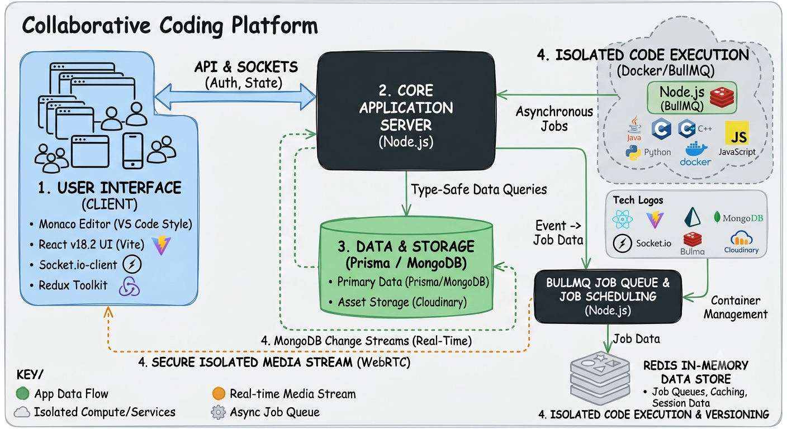

<div align="center">

# CodexUnity ⚡💻

**A real-time collaborative code editor, delta-based version control system, and dual-mode multi-language execution engine built with React, Node.js, Socket.IO, BullMQ, Redis, and Docker.**

[](https://codex-unity-client-five.vercel.app/)

[](https://react.dev/)
[](https://nodejs.org/)
[](https://socket.io/)
[](https://bullmq.io/)
[](https://www.docker.com/)
[](https://www.mongodb.com/)

</div>

---

## 📸 System Architecture

<div align="center">
  
</div>

---

## ✨ Core Features

* **Dual-Mode Code Execution Engine:** 
  * **Self-Hosted / Local Sandbox (`Dockerode`):** Dynamically provisions lightweight, ephemeral **Alpine Linux Docker containers** (`gcc`, `node:alpine`, `python`, `openjdk`) per language, executes untrusted code in isolation, and destroys the container post-execution.
  * **Cloud PaaS Worker (Live Demo):** Adapts to PaaS environments (Render free tier, where Docker-in-Docker is restricted) via an asynchronous cloud compiler worker with rate-limit resilience and exponential backoff.
* **Delta-Based Version Control & Checkpointing:** Memory-efficient code versioning powered by **`diff-match-patch`**—stores periodic 60-second base snapshots and tracks granular intermediate edits as lightweight character-level text deltas in **MongoDB**.
* **Offline-First Resilience (`IndexedDB`):** Automatically detects network drops (`online`/`offline` events), queues code deltas locally inside browser **IndexedDB**, and synchronizes changes in chronological order upon reconnection.
* **Real-Time Collaborative Editing:** Low-latency multi-user code synchronization, room-level access verification, and live participant tracking powered by a dedicated **Socket.IO** server.
* **Context-Aware In-Line Discussions:** Highlight specific code ranges in **Monaco Editor** to start threaded line-by-line discussions and nested replies, complete with click-to-scroll range decorations.

---

## 🛠️ Tech Stack

| Layer | Technologies |
| :--- | :--- |
| **Frontend UI** | React 18, TypeScript, Vite, Tailwind CSS, Monaco Editor, Resizable Panels |
| **State & Caching** | Redux Toolkit, Redux Persist (Auth State), TanStack React Query (Server State) |
| **Offline & Diff Engine** | Browser IndexedDB API, `diff-match-patch`, `use-debounce` |
| **Real-Time Layer** | Socket.IO (Client & Dedicated WebSocket Server) |
| **Core Backend** | Node.js, Express.js, Mongoose (MongoDB), JWT, Bcrypt |
| **Job Queue & Workers** | BullMQ, Redis (In-Memory Data Store), Isolated Background Workers |
| **Execution & DevOps** | Docker Engine, Dockerode (Alpine Linux Containers), Vercel, Render |

---

## 🧠 Engineering Challenges & Solutions

### 1. Sandboxed Execution & Cloud PaaS Adaptation (Dockerode -> Cloud Worker)
* **Challenge:** Running untrusted user code directly on the host server risks infinite loops and system corruption, while deploying ephemeral Docker containers to free cloud PaaS tiers (like Render) is restricted due to Docker-in-Docker (DinD) daemon limitations.
* **Solution:** Built a decoupled **BullMQ** worker architecture supporting two interchangeable execution modes:
  * **Containerized Sandbox Mode:** Uses **Dockerode** to dynamically spin up language-specific lightweight containers (e.g., `node:alpine`, `gcc`), run the code in an isolated environment, and immediately remove the container after completion.
  * **Cloud Production Mode:** Uses a fault-tolerant remote execution worker with **BullMQ exponential backoff** (`2s -> 4s -> 8s`) and tiered error classification (`UnrecoverableError` for `4xx` vs. automatic retries for `429/5xx`), enabling seamless deployment on free cloud hosting without changing a single line of the core Express API.

### 2. Memory-Optimized Version Control with Offline Sync
* **Challenge:** Saving the entire source code file to MongoDB on every keystroke causes rapid database bloat, while network drops during a coding session risk losing unsaved edits.
* **Solution:** Implemented an **Event Sourcing with Periodic Checkpointing** pattern using `diff-match-patch`. The system captures a full base snapshot every 60 seconds and computes compact character-level patches (deltas) after 1-second debounced intervals. If a user goes offline, deltas are buffered locally in **IndexedDB** and sequentially flushed to MongoDB once connectivity is restored.

### 3. High-Concurrency Compilation Queue
* **Challenge:** Heavy compilation workloads (such as C++ or Java) block the single-threaded Node.js event loop and degrade API responsiveness under concurrent user load.
* **Solution:** Decoupled code execution from the core REST API using **BullMQ** and **Redis**. Execution requests immediately return a `jobId` while background workers process jobs asynchronously and update status in MongoDB for non-blocking client status polling.

---

## 🚀 Getting Started Locally

### 1. Prerequisites
Ensure you have the following installed on your local machine:
* **Node.js:** `v18.x` or higher
* **Docker Desktop / Engine:** Required if running the local Dockerode container worker
* **Redis Server:** Running locally or via Docker:
  ```bash
  docker run -d -p 6379:6379 --name codex-redis redis